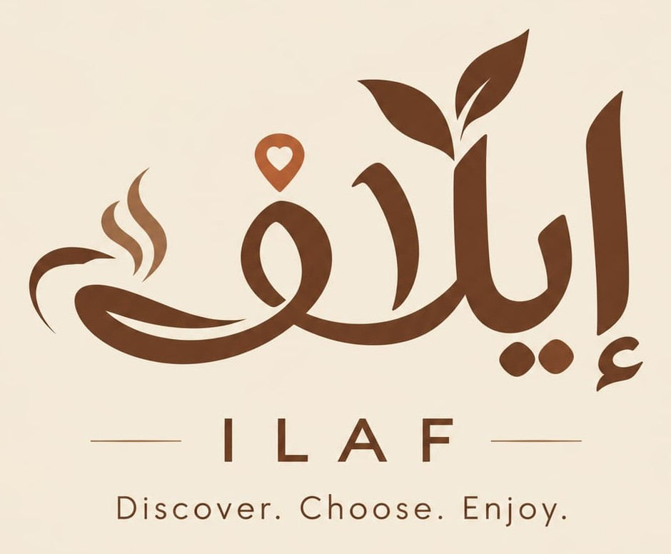
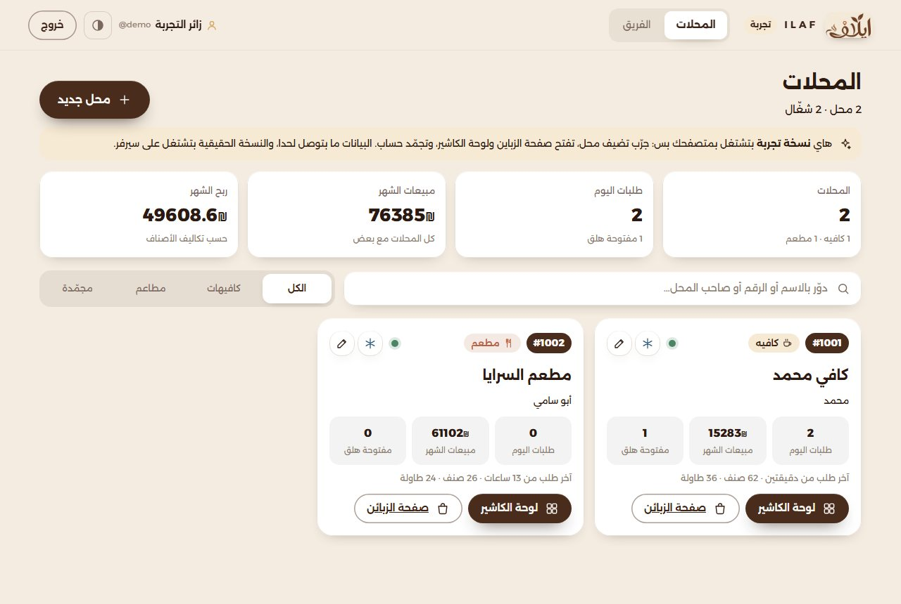
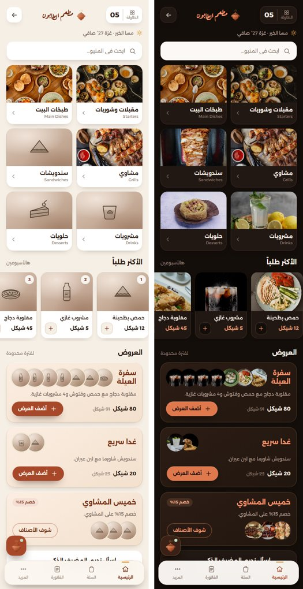
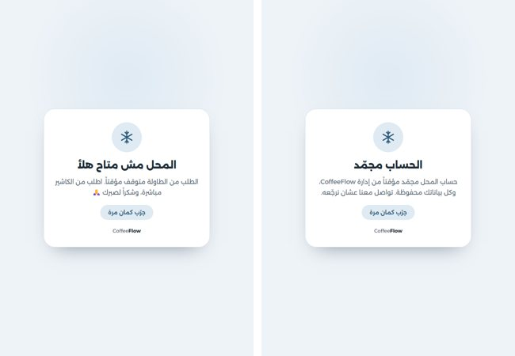
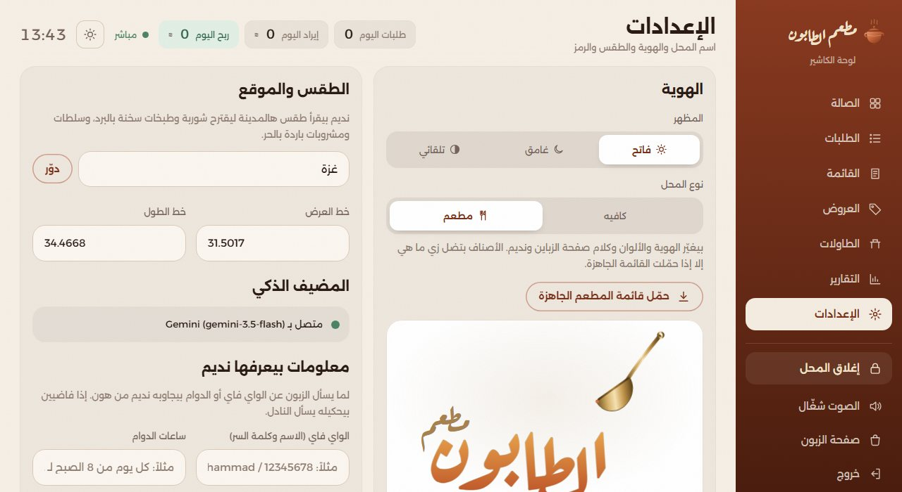
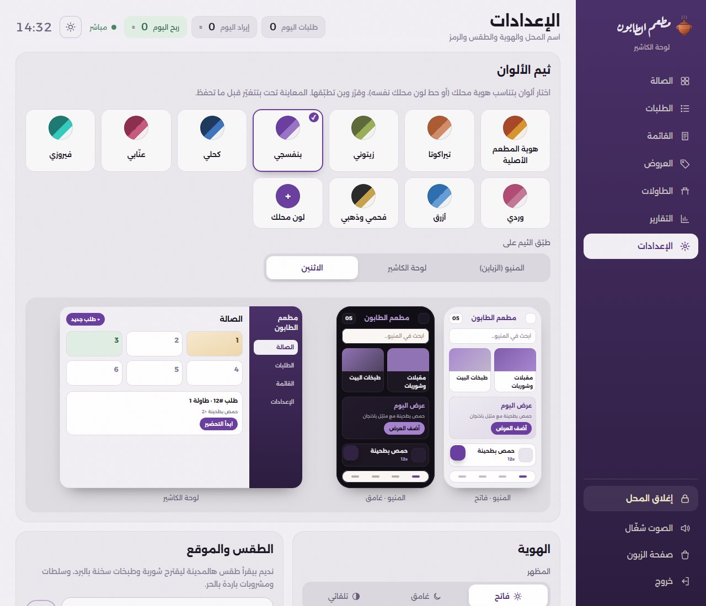
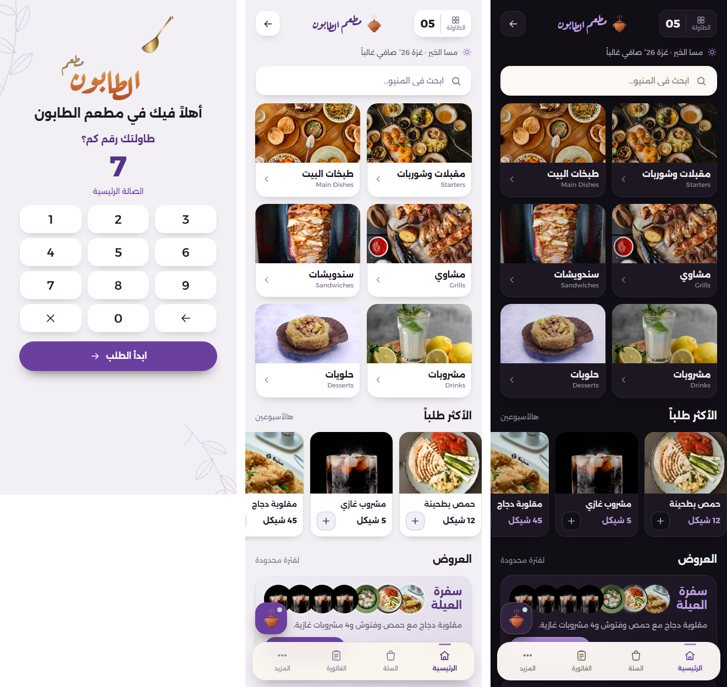

<p align="center"></p>

# إيلاف (ILAF): منصة الطلب الذكي للكافيهات والمطاعم

منصة طلب من الطاولة لأكتر من محل (كافيهات ومطاعم)، كل محل إله رقم وبياناته لحاله:
- **لوحة المنصة** (`/platform`): لإلك ولشريكك، كل واحد بحسابه. بتشوفوا كل المحلات وإحصائياتها، بتضيفوا محل، بتجمّدوا حساب، وبتفتحوا لوحة كاشير أي محل.
- **صفحة الزبون** (`/1001`): بيفتحها من جواله (بمسح QR المحل) وبيطلب.
- **لوحة الكاشير** (`/1001/admin`): الطلبات بتوصلها بنفس اللحظة مع صوت.
- **مساعد ذكي** اسمه "نديم": باريستا بالكافيه، ومضيف بالمطعم. بيدردش مع الزبون وبيقترح عليه وبيعرف شو خلص من المخزن.

## 🔗 جرّبه هلأ (بدون تنزيل، من أي جوال أو كمبيوتر)

| شو | الرابط | ملاحظة |
|---|---|---|
| 🏠 **صفحة التجربة** (كل الروابط) | https://ilaf-onlinerestaurantecosystem.github.io/ilaf-demo/ | ابدأ من هون |
| 🧭 **لوحة منصة إيلاف** | https://ilaf-onlinerestaurantecosystem.github.io/ilaf-demo/platform.html | بتدخل لحالها بحساب التجربة (`demo` / `ilaf2026`) |
| ☕ كافي محمد: صفحة الزبون | https://ilaf-onlinerestaurantecosystem.github.io/ilaf-demo/customer.html | محل رقم 1001 (كافيه) |
| ☕ كافي محمد: لوحة الكاشير | https://ilaf-onlinerestaurantecosystem.github.io/ilaf-demo/admin.html | الرمز **1234** |
| 🍽️ مطعم السرايا: صفحة الزبون | https://ilaf-onlinerestaurantecosystem.github.io/ilaf-demo/customer.html?store=1002 | محل رقم 1002 (مطعم) |
| 🍽️ مطعم السرايا: لوحة الكاشير | https://ilaf-onlinerestaurantecosystem.github.io/ilaf-demo/admin.html?store=1002 | الرمز **1234** |

**شو تجرّب:**
1. افتح **لوحة المنصة**: بتشوف المحلّين وإحصائياتهم. اكبس "محل جديد" واختار كافيه أو مطعم.
2. اكبس ❄️ على أي محل (**تجميد الحساب**) وافتح صفحة زباينه: بتلاقيها مسكّرة. وبعدين "فك التجميد".
3. افتح **لوحة الكاشير** على الكمبيوتر (الرمز 1234)، وامسح الـ QR من قسم "الطاولات" بجوالك، واطلب: الطلب بيوصل للوحة بنفس اللحظة.
4. اسأل **نديم** بصفحة الزبون (بالكافيه باريستا، وبالمطعم مضيف). وعشان يحكي بذكاء Gemini، حط مفتاح Gemini المجاني من إعدادات لوحة الكاشير.

> ⚠️ هاي **نسخة تجربة بتشتغل بالمتصفح بس** (GitHub Pages، بدون سيرفر): كل زائر إله بياناته بمتصفحه، وما حدا بيشوف بيانات غيره.
> النسخة الحقيقية (سيرفر + قاعدة بيانات + دومين) هي نفس الكود بمجلد `server/`، وشرح تشغيلها تحت.

## 📦 للتسليم (خبير قواعد البيانات والسيرفر)

| الملف | شو فيه |
|---|---|
| [docs/REQUIREMENTS.md](docs/REQUIREMENTS.md) | **المطلوب خطوة خطوة**: إنشاء محل ← رابط لوحة الكاشير ← روابط الطاولات والمنيو، الطلبات (إنشاء، تعديل، إلغاء)، ثيم الألوان، التجميد، وقائمة فحص بعد الربط |
| [docs/HANDOVER.md](docs/HANDOVER.md) | الشرح التقني: هيكل الكود، كل الـ API، وكيف تبدّل التخزين بـ PostgreSQL وتحط دومين و HTTPS |
| [docs/schema.sql](docs/schema.sql) | تصميم قاعدة البيانات (مرحلة 1 جاهزة، ومرحلة 2 مفصّلة) |
| [.env.example](.env.example) | متغيرات البيئة (مفاتيح نديم، المنفذ، `DATABASE_URL`) |
| [server/db.js](server/db.js) و [server/platform-store.js](server/platform-store.js) | **الملفين اللي بيتبدّلوا** لما ننقل التخزين لـ PostgreSQL |
| [screenshots/](screenshots) | صور كل الشاشات |

**المستودعات:**
- الكود كامل: https://github.com/ILAF-OnlineRestaurantEcosystem/ilaf
- موقع التجربة (GitHub Pages، ملفات مبنية من الكود): https://github.com/ILAF-OnlineRestaurantEcosystem/ilaf-demo

**على السيرفر الحقيقي** (بعد `npm start`، والدومين بدل `localhost:3000`):

| الصفحة | الرابط |
|---|---|
| لوحة المنصة | `http://localhost:3000/platform` (أول مرة: **رمز الإعداد** بيطلع بشاشة السيرفر) |
| صفحة زبائن محل | `http://localhost:3000/1001` |
| لوحة كاشير محل | `http://localhost:3000/1001/admin` (الرمز الافتراضي **1234**) |

## 🖼️ صور

**كل الشاشات (36 صورة):** مجلد [screenshots/all](screenshots/all)

<p>

</p>
<p>


</p>
<p>

</p>
<p>

</p>
<p>

</p>

## المنصة (إيلاف)
- **رقم لكل محل:** `1001`، `1002`… ورابط الزبائن `/<الرقم>` ولوحة الكاشير `/<الرقم>/admin`.
- **كافيه أو مطعم:** النوع بيغيّر الهوية (الكافيه: دلّة نحاس وبني قهوة، المطعم: قدرة فخار ومغرفة بألوان التيراكوتا والزعفران)، وكلام صفحة الزبون ونديم، وفي قائمة جاهزة لكل نوع بصورها (المطعم: مقبلات، طبخات، مشاوي، سندويشات، مشروبات، حلويات).
- **ثيم الألوان:** الكاشير بيختار هوية المحل الأصلية أو ثيم جاهز (بنفسجي، زيتوني، كحلي…) أو لون محله نفسه، وبيطبّقه على المنيو أو لوحته أو الاثنين، مع معاينة قبل الحفظ.
- **QR لكل طاولة:** `/<الرقم>?table=7` بيفتح المنيو ورقم الطاولة جاهز، وفي كمان QR واحد للمحل كله.
- **تجميد الحساب:** المحل المجمّد ما حدا بيقدر يوصله (الزباين بيشوفوا "المحل مش متاح هلأ" والكاشير "الحساب مجمّد")، واللي فاتحين الصفحة بتتسكّر عندهم بنفس اللحظة. البيانات بتضل محفوظة وبترجع لما تفك التجميد.
- **الفريق:** كل شريك بحسابه وكلمة سرّه. أول حساب بيحتاج **رمز إعداد** بيطلع بشاشة السيرفر أول مرة.

## شو بيعمل

**صفحة الزبون:**
- **رقم الطاولة أول اشي:** بتسأل عنه قبل أي طلب.
- **فاتورة الطاولة:** كل طلبات الطاولة، حتى من أكثر من جوال، بتنجمع بفاتورة وحدة لحد ما الكاشير يسكّرها. وإذا الزبون سكّر الموقع ورجع، بيسأله: "لسا قاعد على طاولة 20؟".
- **المنيو بالصور:** وفيه "الأكثر طلباً" والعروض.
- **ساعدنا نختارك:** ثلاث أسئلة، وبعدها "اختيارنا لك اليوم".
- **السلة والمتابعة:** السلة والإرسال، ومتابعة حالة كل طلب لحظة بلحظة.
- **نادِ نادل، واطلب الحساب.**
- **نديم:**
  - بيشرح كل مشروب من شو بيتكوّن، وبيقارن بين المشروبات.
  - بيقترح حسب الميزانية والطقس وعدد الأشخاص والطاولة.
  - بيدردش، وبيحكي بصراحة إذا صنف مش موجود وبيقترح الأقرب.

**لوحة الكاشير:**
- **الصالة:** مربعات الطاولات بتضوي مع صوت لما يجي طلب أو نداء.
- **خصم على صنف بفاتورة وحدة بس**، بدون ما يتغيّر سعره بالقائمة.
- **التكلفة والربح:** لكل صنف سعر بيع وتكلفة، وبيبيّن الربح ونسبته.
- **إغلاق المحل:** بيحفظ تقرير اليوم وبيصفّر عدّاد اليوم.
- **التقارير الشهرية:**
  - اختيار الشهر، والمقارنة مع الشهر اللي قبله.
  - المبيعات يوم بيوم، والأصناف بأرباحها، وسجل الشهور.
  - زر **تحميل PDF**.
- **الأرشيف:** تقرير كل شهر خلص بيتحفظ للأبد، والطلبات القديمة بتنحذف بعد ما ينحفظ تقريرها.
- **نسخة احتياطية:** تنزيلها واسترجاعها من الإعدادات.
- **القائمة والعروض والمناطق.**
- **QR واحد للمحل.**
- **معلومات بيعرفها نديم:** الواي فاي والدوام وملاحظات عن المحل.
- **المخزن:** كمية لكل صنف، بتنقص مع كل طلب وبترجع إذا انلغى، وبيطلع للزبون "باقي 3 بس". نديم بيعرف شو خلص.
- **طلبات من الكاشير:** طلب لطاولة، أو **طلب خارجي** (تيك أواي) لكل زبون لحاله، وتعديل أي طلب.

## نسختين من نفس الكود

| | نسخة السيرفر (Node) | نسخة الموقع الثابت (GitHub Pages) |
|---|---|---|
| التشغيل | `npm start` | ملفات HTML بتنبني بـ `npm run build:html` |
| المحلات | كل المحلات + لوحة المنصة | كمان (تجربة بمتصفح كل زائر لحاله، `?store=` لكل محل) |
| البيانات | `data/platform.json` و `data/tenants/<رقم>.json` (لاحقاً PostgreSQL) | بمتصفح جهاز الكاشير (مع نسخة احتياطية) |
| الربط بين الأجهزة | Socket.io | وسيط MQTT عام ومجاني (`standalone/relay.js`) |
| نديم الذكي | مفتاح بملف `.env` | المفتاح بيتحط من إعدادات لوحة الكاشير |

**بنسخة الموقع:**
- **الكاشير جهاز واحد:** أول جهاز بيفتح اللوحة وبيدخل بالرمز بيصير هو الكاشير. أي لوحة تانية بتستنى، وفيها زر "خلّي هالجهاز هو الكاشير".
- **رابط الزبائن ثابت:** `customer.html`.
- **الطلب ما بيضيع:** إذا الكاشير مسكّر اللوحة، بينحفظ وبيوصله أول ما يفتحها.

## التشغيل (للمبرمج)
1. نزّل **Node.js 22** أو أحدث من nodejs.org
2. بمجلد المشروع نفّذ:
   ```bash
   npm install
   npm start
   ```
3. افتح:
   - لوحة المنصة: http://localhost:3000/platform (أول مرة: اكتب **رمز الإعداد** اللي طلع بشاشة السيرفر، واعمل حسابك)
   - صفحة زبائن أول محل: http://localhost:3000/1001
   - لوحة الكاشير: http://localhost:3000/1001/admin (الرمز **1234**)
4. **نديم الذكي (اختياري):** انسخ `.env.example` باسم `.env`، وحط مفتاح Gemini المجاني من aistudio.google.com/apikey. **ملف `.env` ما بينرفع على GitHub أبداً.**

**أوامر تانية:**
- `npm run dev`: بيعيد تشغيل السيرفر لحاله مع كل تعديل.
- `npm run reset`: بيرجّع البيانات التجريبية.
- `npm run build:html`: بيبني نسخة الموقع بمجلد `hosting/`، وملفّين مستقلين بمجلد `dist/`.

**تحديث موقع GitHub Pages:** ابني بـ `npm run build:html`، وانسخ ملفات `hosting/` (index.html وcustomer.html وadmin.html وplatform.html) لمستودع [ilaf-demo](https://github.com/ILAF-OnlineRestaurantEcosystem/ilaf-demo).

## وين بتلاقي كل اشي

```
server/
  core.js        كل مسارات الـ API (نفسها بتشتغل بالسيرفر وبنسخة الموقع)
  logic.js       الأسعار والعروض، الطلبات، الفواتير، إغلاق اليوم، التقارير الشهرية والأرشيف
  reports.js     حساب التكلفة والربح
  seed.js        القائمة والطاولات والبيانات التجريبية
  db.js          حفظ البيانات (ملف JSON لكل محل) ← هاد اللي بيتبدّل بـ PostgreSQL
  platform.js    المنصة: الحسابات، سجل المحلات، الإحصائيات، التجميد
  seed-restaurant.js  قائمة المطعم الجاهزة
  weather.js     الطقس (Open-Meteo، مجاني)
  barista/       نديم: prompt.js (تعليماته)، gemini.js وclaude.js، fallback.js (الوضع الأساسي بدون مفتاح)
  index.js       سيرفر Express + Socket.io
public/
  index.html, js/customer.js    صفحة الزبون
  admin.html, js/admin.js       لوحة الكاشير
  platform.html, js/platform.js لوحة المنصة
  frozen.html                   صفحة "الحساب مجمّد"
  js/art.js      الشعار والأيقونات والرسومات
  css/           base (الألوان)، brand، app (الزبون)، admin (اللوحة)
standalone/
  runtime.js     تشغيل core.js جوّا المتصفح (نسخة الموقع)
  relay.js       الربط بين الأجهزة بدون سيرفر (MQTT)، والكاشير الواحد، وطابور الطلبات
  db-browser.js  حفظ البيانات بالمتصفح (كل محل لحاله)
  demo-registry.js, platform-runtime.js  تجربة المنصة بالمتصفح (حساب demo، محلات، تجميد)
scripts/build-standalone.mjs   بيبني نسخة الموقع
```

## الهوية البصرية
- **الكافيه:** دلّة قهوة بتصب، وكلمة "محمد" بخط الرقعة بتتعبّى قهوة. الألوان: بيج `#F4ECE1`، بني قهوة `#6B4A2F` و`#4A3220`، نحاسي `#A8834F`.
- **المطعم:** قدرة فخار (أيقونة) ومغرفة نحاس بتصب مرق زعفراني بالكلمة. الألوان: كريمي `#F6EFE6`، تيراكوتا `#A8482A`، زعفران `#D9952E`، وفحم `#140E0B` بالغامق.
- **إيلاف (ILAF):** شعار المنصة بمجلد `public/brand/` (الشعار كامل، الكلمة، والأيقونة)، والاسم والجملة بـ `public/js/brand.js`.
- **الخطوط:** Alexandria للنصوص، وAref Ruqaa للشعار.

## التقنيات
Node.js + Express + Socket.io · Gemini أو Claude لنديم · Open-Meteo للطقس · MQTT عبر WebSocket للربط بنسخة الموقع · HTML/CSS/JS بدون أدوات بناء.
